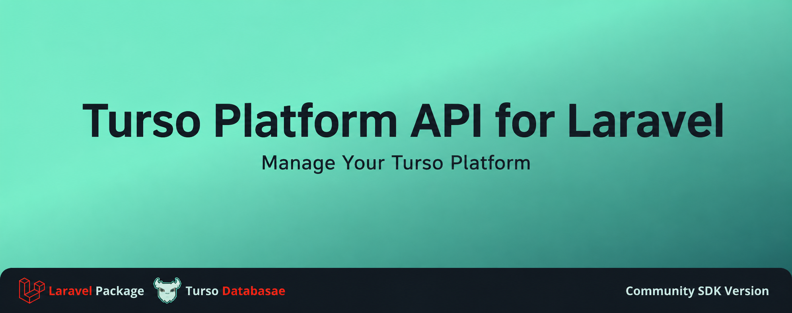

<p align="center">
  <a href="https://discord.gg/turso">
    <picture>
      <source media="(prefers-color-scheme: dark)" srcset="https://i.imgur.com/UhuW3zm.png">
      <source media="(prefers-color-scheme: light)" srcset="https://i.imgur.com/vljWbfr.png">
      
    </picture>
  </a>
</p>

<p align="center">
  
</p>

<p align="center">
  <a href="LICENSE"></a>
  <a href="https://github.com/darkterminal/turso-platform-laravel/actions/workflows/tests.yml"></a>
  <a href="https://tur.so/discord-php"></a>
  <a href="#contributors"></a>
  <a href="https://packagist.org/packages/darkterminal/turso-platform-laravel"></a>
  <a href="https://github.com/darkterminal/turso-platform-laravel/tags"></a>
</p>

# Turso Platform API for Laravel

Laravel integration for `darkterminal/turso-api-client-php` — exposes the Turso Platform API as a pre-configured shared client: publishable config, auto-discovered Service Provider, and a Facade so calls read naturally in Laravel apps.

Latest release: **v1.1.0** (2026-11-12). PHP 8.3+ · Laravel 12+.

## Requirements

| Component | Version |
|---|---|
| PHP | 8.3+ |
| Laravel | 12+ |
| `darkterminal/turso-api-client-php` | `^2.1` (auto-installed) |

## Installation

```bash
composer require darkterminal/turso-platform-laravel
```

The Service Provider and Facade are auto-discovered. No manual registration needed.

## Configuration

```dotenv
TURSO_PLATFORM_API_TOKEN=your-platform-api-jwt
TURSO_PLATFORM_ORGANIZATION=your-org-slug       # optional
TURSO_PLATFORM_ORGANIZATION_ID=your-org-uuid    # required for v3 recovery operations
TURSO_PLATFORM_BASE_URL=https://api.turso.tech  # optional override
```

Publish the config if you need to customize:

```bash
php artisan vendor:publish --provider="Darkterminal\TursoPlatformLaravel\TursoPlatformServiceProvider" --tag=turso-platform-config
```

## Usage

### Via Facade

```php
use Darkterminal\TursoPlatformLaravel\TursoPlatform;

$databases = TursoPlatform::databases()->list();
$token     = TursoPlatform::databases()->createToken('main', 'never', \Darkterminal\TursoPlatformAPI\Enums\Authorization::FULL_ACCESS);
```

### Via container injection

```php
use Darkterminal\TursoPlatformAPI\Client\Client;

public function index(Client $client)
{
    $databases = $client->databases()->list();
    // ...
}
```

### Via manager

```php
use Darkterminal\TursoPlatformLaravel\TursoPlatformManager;

$client = app(TursoPlatformManager::class)->client();
$databases = $client->databases()->list();
```

## Uploading a SQLite dump

Uploads ship with the SDK (`darkterminal/turso-api-client-php`), not this package:

```php
use Darkterminal\TursoPlatformAPI\Integrations\DatabaseUploader;

// Host and token come from a database created with seed.type='database_upload'.
$uploader = new DatabaseUploader($hostname, $databaseToken);
$body = $uploader->uploadDump('/path/to/dump.db');  // WAL, page_size=4096, auto_vacuum=0, UTF-8
```

## Documentation

- [Facade map](docs/facade-map.md) — full resource inventory, env→builder mapping, contract quirks
- [Architecture notes](docs/architecture.md) — container pipeline, bindings, lazy resolution, quality gates
- [Troubleshooting](docs/troubleshooting.md) — `TURSO_PLATFORM_API_TOKEN`, publish tag, v3 recovery UUID, config cache
- [CHANGELOG](CHANGELOG.md)
- [Wiki](https://github.com/darkterminal/turso-platform-laravel/wiki) — the same content rendered for GitHub browsing (Home, Facade Map, Architecture, Troubleshooting)

## Security notes

- `TURSO_PLATFORM_API_TOKEN` is only attached as a Bearer header to requests bound for the configured base URL. It is never attached to upload or resolver hosts (those are separate integrations handled by `darkterminal/turso-api-client-php`).
- See `turso-api-client-php` for the full set of retry/timeout/error behaviors and the contract-aligned exception hierarchy.

## Contributors

See the [contributor graph](https://github.com/darkterminal/turso-platform-laravel/graphs/contributors) on GitHub.

## Contributing & Security

Report issues or feature requests via [GitHub Issues](https://github.com/darkterminal/turso-platform-laravel/issues). Report vulnerabilities privately via [GitHub Security Advisories](https://github.com/darkterminal/turso-platform-laravel/security/advisories/new).

## License

MIT — see [LICENSE](LICENSE).
