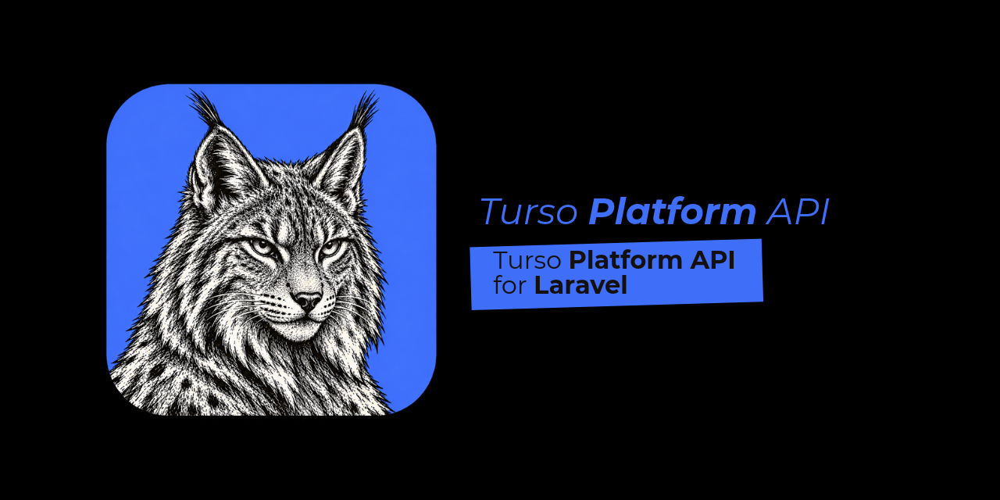

<p align="center">
  <a href="https://discord.gg/turso">
    <picture>
      <source media="(prefers-color-scheme: dark)" srcset="https://i.imgur.com/UhuW3zm.png">
      <source media="(prefers-color-scheme: light)" srcset="https://i.imgur.com/vljWbfr.png">
      
    </picture>
  </a>
</p>

<p align="center">
  
</p>

<p align="center">
  <a href="LICENSE"></a>
  <a href="https://github.com/darkterminal/turso-platform-laravel/actions/workflows/tests.yml"></a>
  <a href="https://tur.so/discord-php"></a>
  <a href="#contributors"></a>
  <a href="https://packagist.org/packages/darkterminal/turso-platform-laravel"></a>
  <a href="https://github.com/darkterminal/turso-platform-laravel/tags"></a>
</p>

# Turso Platform for Laravel

Laravel integration for [`darkterminal/turso-api-client-php`](https://github.com/darkterminal/turso-api-client-php) — exposes the Turso Platform API as a pre-configured shared client with publishable config, auto-discovered service provider, and a Facade.

This package is a **thin wiring layer**. HTTP, request/response contracts, validation, and typed exceptions live in the core SDK. Use it to manage Turso Platform control-plane resources from Laravel apps: databases, groups, organizations, members, invites, API tokens, audit logs, and recovery.

> This package is for Platform API automation, not SQL/data-plane queries. For database queries, use a libSQL/Turso database client.

## Documentation

- **Docs site / User manual**: [darkterminal.github.io/turso-platform-laravel](https://darkterminal.github.io/turso-platform-laravel/)
- **Getting started**: [User manual — Getting started](https://darkterminal.github.io/turso-platform-laravel/user-manual/getting-started/)
- **Configuration**: [User manual — Configuration](https://darkterminal.github.io/turso-platform-laravel/user-manual/configuration/)
- **Facade map**: [User manual — Facade map](https://darkterminal.github.io/turso-platform-laravel/user-manual/reference/facade-map/)
- **Repo docs**: [`docs/`](docs/), [`docs/facade-map.md`](docs/facade-map.md), [`docs/architecture.md`](docs/architecture.md), [`docs/troubleshooting.md`](docs/troubleshooting.md)
- **Changelog**: [CHANGELOG.md](CHANGELOG.md)

## Requirements

| Component | Version |
|---|---|
| PHP | 8.3+ |
| Laravel | 12+ |
| `darkterminal/turso-api-client-php` | `^2.1` (installed by Composer) |

## Installation

```bash
composer require darkterminal/turso-platform-laravel
```

The service provider and facade are auto-discovered. No manual registration is required.

## Configuration

Set environment variables:

```dotenv
TURSO_PLATFORM_API_TOKEN=your-platform-api-token
TURSO_PLATFORM_ORGANIZATION=your-org-slug          # optional, required for most org-scoped resources
TURSO_PLATFORM_ORGANIZATION_ID=your-org-uuid       # optional, required for v3 recovery
TURSO_PLATFORM_BASE_URL=https://api.turso.tech      # optional
TURSO_PLATFORM_TIMEOUT=20                           # optional, seconds
```

Publish the config if you need to customize defaults:

```bash
php artisan vendor:publish --provider="Darkterminal\TursoPlatformLaravel\TursoPlatformServiceProvider" --tag=turso-platform-config
```

> The Platform API token is read from `TURSO_PLATFORM_API_TOKEN` at resolution time. It is intentionally not stored in the published config file.

## Usage

### Facade

```php
use Darkterminal\TursoPlatformLaravel\TursoPlatform;

$databases = TursoPlatform::databases()->list();
$user = TursoPlatform::user()->get();
```

### Container injection

```php
use Darkterminal\TursoPlatformAPI\Client\Client;

public function index(Client $client)
{
    return $client->databases()->list();
}
```

### Manager

```php
use Darkterminal\TursoPlatformLaravel\TursoPlatformManager;

$client = app(TursoPlatformManager::class)->client();
$databases = $client->databases()->list();
```

## Resources

The facade maps 1:1 to the SDK client resources:

| Facade | Purpose |
|---|---|
| `TursoPlatform::user()` | Current user |
| `TursoPlatform::auth()` | Token validation |
| `TursoPlatform::locations()` | Available locations |
| `TursoPlatform::organizations()` | Organizations, plans, invoices, subscription, usage |
| `TursoPlatform::members()` | Organization members |
| `TursoPlatform::invites()` | Organization invites |
| `TursoPlatform::databases()` | Databases, config, instances, tokens, usage, stats |
| `TursoPlatform::groups()` | Groups, locations, config, tokens, transfer/unarchive |
| `TursoPlatform::apiTokens()` | Personal Platform API tokens |
| `TursoPlatform::organizationApiTokens()` | Organization-scoped Platform API tokens |
| `TursoPlatform::auditLogs()` | Organization audit logs |
| `TursoPlatform::recovery()` | v3 deleted database/group recovery (requires org UUID) |

See the full [Facade map](https://darkterminal.github.io/turso-platform-laravel/user-manual/reference/facade-map/) and the upstream [SDK API map](https://github.com/darkterminal/turso-api-client-php/blob/main/docs/api-map.md) for method-level signatures.

## SDK integrations

Standalone SDK integrations can be used directly alongside this package:

```php
use Darkterminal\TursoPlatformAPI\Integrations\DatabaseUploader;

$uploader = DatabaseUploader::create(
    baseUrl: config('turso-platform.base_url'),
    organization: config('turso-platform.organization'),
    token: env('TURSO_PLATFORM_API_TOKEN'),
);
```

Check the SDK docs for the exact integration signatures in your installed version.

## Troubleshooting

Common issues are covered in the [Errors and troubleshooting](https://darkterminal.github.io/turso-platform-laravel/user-manual/errors-troubleshooting/) manual page, including:

- missing `TURSO_PLATFORM_API_TOKEN`;
- v3 recovery requiring `TURSO_PLATFORM_ORGANIZATION_ID` (UUID, not slug);
- 401/403 from using the wrong token type;
- config publish tag and package discovery.

## Security notes

- `TURSO_PLATFORM_API_TOKEN` is read from the environment and attached only to configured Platform API requests by the SDK.
- Do not put the Platform API token in published config files.
- Protect routes/actions that manage tokens, members, invites, or recovery with Laravel authorization.

## Contributors

See the [contributor graph](https://github.com/darkterminal/turso-platform-laravel/graphs/contributors) on GitHub.

## Contributing & Security

Report issues or feature requests via [GitHub Issues](https://github.com/darkterminal/turso-platform-laravel/issues). Report vulnerabilities privately via [GitHub Security Advisories](https://github.com/darkterminal/turso-platform-laravel/security/advisories/new).

## License

MIT — see [LICENSE](LICENSE).
